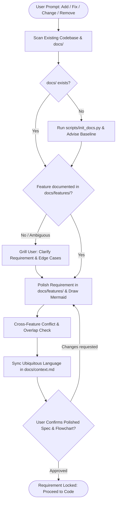

# Project Documentation: Requirements First, Code Later

This skill is **not about how things are coded**. It is a **requirement-polishing and alignment engine**: it takes the user's raw prompt ("add this", "fix that", "remove this"), reconciles it against the existing codebase, and polishes it into a crisp, unambiguous specification so that **both user and AI share the exact same understanding before any coding begins**.

Docs describe the system *as it is right now* (never a changelog). When a feature is removed, delete its document and all references to it.

---

## 1. The Lean `docs/` Structure

To minimize token overhead and maximize visual clarity, documentation is organized into single root files and scalable subfolders:

```text
docs/
├── README.md                      # Index, overview, and feature status table
├── context.md                     # [Single file] Canonical ubiquitous language & global invariants
├── architecture.md                # [Single file] High-level stack, component diagram & data models
├── features/                      # [Multi-file] Scalable: 100+ separate feature specs
│   ├── 001-user-auth.md           # Polished spec + Mermaid flowchart + rules + conflict check
│   └── 002-order-checkout.md
└── decisions/                     # [Multi-file] Architecture Decision Records (ADRs)
    └── 001-db-choice.md
```

- **Singletons (flat, unnumbered)**: Global sources of truth (`README.md`, `context.md`, `architecture.md`).
- **Multi-file collections (`<NNN>-<kebab>.md`)**: Feature specs and ADRs that grow with the project.
- **Strictly script-driven**: Never manually craft boilerplate files. Run `scripts/init_docs.py` to scaffold the entire tree and templates, and `scripts/new_doc.py features <name>` to scaffold new features. All templates and formats are pre-bundled in the scripts to eliminate prompt token overhead.

---

## 2. Requirement Polishing Workflow

Every development request (add, fix, modify, or remove) goes through requirement polishing before any code is touched:



### Step 1: Scan & Baseline
- Scan the existing codebase and docs to understand the current reality.
- If `docs/` is missing, run `python scripts/init_docs.py` to scaffold boilerplate templates instantly without spending LLM tokens.
- **Existing codebase without docs**: Recommend documenting the current baseline first before introducing new features.

### Step 2: Requirement Polishing & Grilling
- Do not make assumptions. If the user prompt is high-level, missing edge cases, or introduces an undocumented feature:
- **Grill the user first**: Ask concise, numbered questions with recommended answers covering user journey, validation rules, error handling, and data models.

### Step 3: Visual Spec (Flowchart & Conflict Audit)
Create or update `docs/features/<NNN>-<kebab-name>.md` using `python scripts/new_doc.py features <name>`:
1. **Mermaid Flowchart**: Every feature MUST include a Mermaid flowchart modeling its user journey, logic branches, or state machine.
2. **Polished Rules**: Explicit functional requirements and boundary conditions.
3. **Cross-Feature Conflict Check**: Explicitly audit adjacent features in `docs/features/`:
   - Does this new/modified feature contradict existing business rules?
   - Are there overlapping state transitions, duplicated responsibilities, or competing endpoints?
   - If a conflict is found, flag it with clear resolution options.

### Step 4: Synchronize Ubiquitous Language
`docs/context.md` binds domain concepts to code identifiers:
- Keep one canonical term per concept (e.g. `Buyer`). List forbidden synonyms in `Avoid` (`customer`, `client`).
- The canonical term is the exact name to be used in code identifiers (`buyerId`, `BuyerService`).

### Step 5: User Confirmation Gate (Prettier Temporary `docs/SUMMARY.md`)
Instead of dumping walls of raw text into the terminal, write the alignment summary to a temporary `docs/SUMMARY.md` so it renders beautifully in markdown preview (with side-by-side tables and formatted Mermaid charts). It is automatically ignored in git via `.gitignore`.

The `docs/SUMMARY.md` must follow this structure:
1. **Overview**: 1-2 sentence plain-language summary of what the request accomplishes.
2. **Side-by-Side Comparison (What It Is vs. What Changes)**:
   - Markdown table comparing `Area / Context`, `Before (Current System)`, `After (Proposed Change)`, and `Document Reference` (linking to specific sections in `docs/features/`, `docs/context.md`, or `docs/architecture.md`).
   - Written in everyday, plain human language (strictly no code diffs or programming jargon).
3. **Flow Comparison (Before vs. After)**:
   - Two separate Mermaid blocks: `### Current Flow (Before)` and `### Proposed Flow (After)`.
   - In the proposed flow, highlight modified/added nodes using high-contrast styles with crisp white text (`color:#ffffff`) and clean text labels (no emoji icons in node text):
     - `classDef added fill:#064e3b,stroke:#34d399,stroke-width:3px,color:#ffffff;` (Green)
     - `classDef changed fill:#78350f,stroke:#fbbf24,stroke-width:3px,color:#ffffff;` (Amber)
4. **Cross-Feature Conflict & Overlap Check**:
   - Table auditing checked documents, potential collisions, resolutions, and status.
5. **User Confirmation**:
   - Concise prompt asking the user to confirm or adjust the understanding.

In the terminal/chat, provide only a short notification with a link to `docs/SUMMARY.md`:
> *"I have prepared the requirement alignment summary in `docs/SUMMARY.md`. Please review the Before/After comparison and flowcharts, and let me know if this matches your understanding or if anything needs correction before we proceed."*

**Wait for the user's confirmation or corrections before writing or modifying any code.** Once confirmed and implementation is complete, delete the temporary `docs/SUMMARY.md`.

---

## 3. Removals & Refactoring

When a requirement is removed or replaced:
- Delete the corresponding `docs/features/<NNN>-<name>.md`.
- Prune all references to it in `docs/README.md`, `docs/context.md`, and dependent feature specs.
- Docs must always reflect current reality, never dead features.

---

## 4. Helpers & Validation

Run from project root (Python standard library only):
- `python scripts/init_docs.py`: Scaffolds the lean structure with starter templates.
- `python scripts/new_doc.py features <name>`: Allocates the next feature doc with Mermaid flowchart and conflict check boilerplate.
- `python scripts/docs_lint.py`: Validates structure, headers, Mermaid diagrams, and conflict sections.
- `python scripts/glossary_lint.py`: Validates `docs/context.md` table and scans code for forbidden synonyms (`--scan`).
- `python scripts/adr_scan.py`: Validates ADR integrity in `docs/decisions/`.
